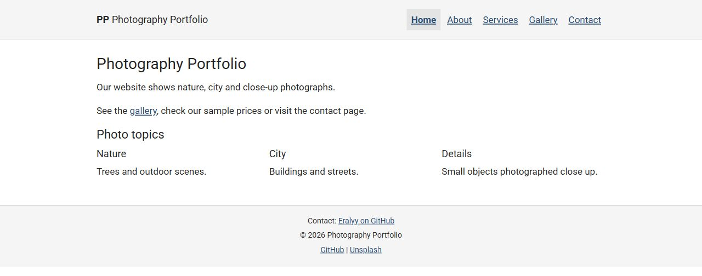
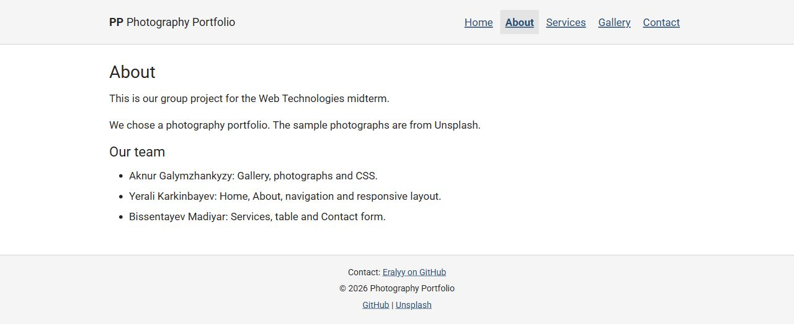
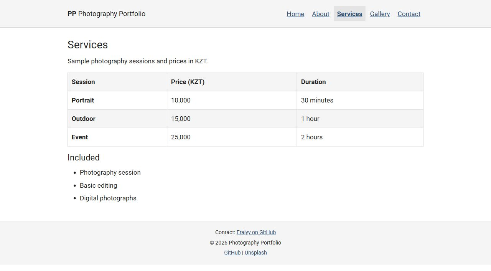
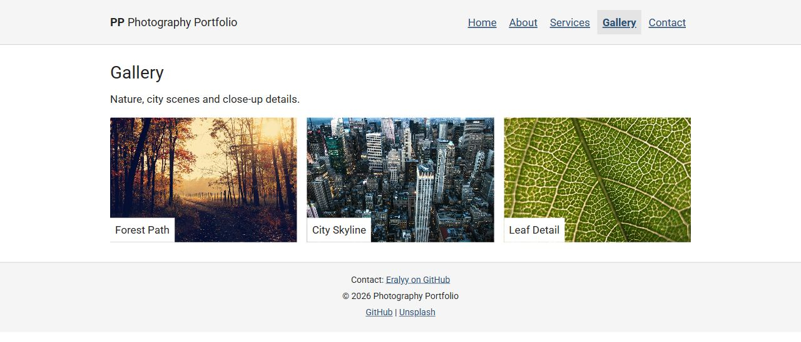
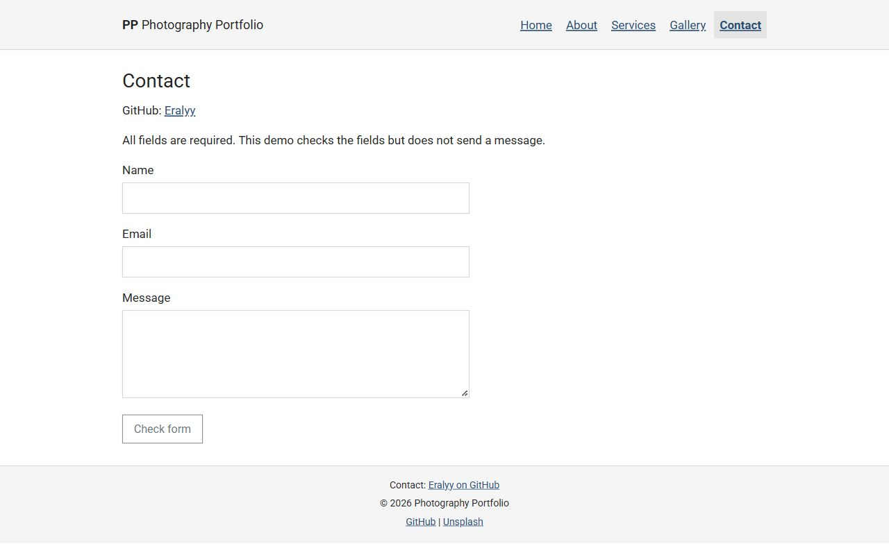

# Photography Portfolio Website

Topic: Photography Portfolio Website.

## Description

We made this photography website for our Web Technologies midterm and added interactive features for the endterm. It has photos, sample services and prices, and forms you can try in the browser.

## Group members and responsibilities

| Member | Midterm work | Endterm work |
| --- | --- | --- |
| Aknur Galymzhankyzy | Gallery page, photos, CSS Grid and gallery styles | JavaScript for the forms, search, service table and lightbox; jQuery; README |
| Yerali Karkinbayev | Home and About pages, navigation, Flexbox header and responsive layout | CSS for the new forms, filters, table and lightbox |
| Bissentayev Madiyar | Services and Contact pages, pricing table and contact form | HTML for the registration form, service controls, gallery filters and lightbox |

## Features

- Five connected pages: Home, About, Services, Gallery and Contact. Each page has a header, navigation, main content and footer.
- The layout uses Bootstrap, Flexbox and CSS Grid. The photos and page layout adjust for phones, tablets and wider screens.
- The Contact page still has the original contact form. It checks required fields but does not send a message.
- The new registration demo checks name, email, password and password confirmation. It shows feedback while you type, checks email with a regular expression and shows weak, medium or strong password strength. It does not create an account.
- On Gallery, you can search photos by name, filter them by category and open them in a lightbox. The arrows move between photos, and jQuery adds fade effects.
- On Services, you can add, view, edit and delete rows in the table. Delete asks for confirmation. The changes stay on the page until you reload it.

## Technologies

HTML5, CSS3, Bootstrap 5.3.8, JavaScript, jQuery 4.0.0 and Roboto from Google Fonts. Bootstrap and jQuery are stored in this repository. The sample photos are from Unsplash.

## Website

[Open the website](https://eralyy.github.io/photography-midterm/)

To open locally, open `index.html` in a browser. The project is a static website, so it does not need a server or database.

## Midterm screenshots

These screenshots show the original midterm pages, before the endterm features were added.

### index.html

### about.html

### services.html

### gallery.html

### contact.html

<!--
Bootstrap v5.3.8 (https://getbootstrap.com/)

The MIT License (MIT)

Copyright (c) 2011-2025 The Bootstrap Authors

Permission is hereby granted, free of charge, to any person obtaining a copy
of this software and associated documentation files (the "Software"), to deal
in the Software without restriction, including without limitation the rights
to use, copy, modify, merge, publish, distribute, sublicense, and/or sell
copies of the Software, and to permit persons to whom the Software is
furnished to do so, subject to the following conditions:

The above copyright notice and this permission notice shall be included in
all copies or substantial portions of the Software.

THE SOFTWARE IS PROVIDED "AS IS", WITHOUT WARRANTY OF ANY KIND, EXPRESS OR
IMPLIED, INCLUDING BUT NOT LIMITED TO THE WARRANTIES OF MERCHANTABILITY,
FITNESS FOR A PARTICULAR PURPOSE AND NONINFRINGEMENT. IN NO EVENT SHALL THE
AUTHORS OR COPYRIGHT HOLDERS BE LIABLE FOR ANY CLAIM, DAMAGES OR OTHER
LIABILITY, WHETHER IN AN ACTION OF CONTRACT, TORT OR OTHERWISE, ARISING FROM,
OUT OF OR IN CONNECTION WITH THE SOFTWARE OR THE USE OR OTHER DEALINGS IN
THE SOFTWARE.
-->
